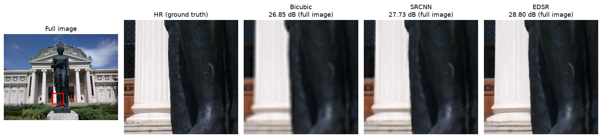
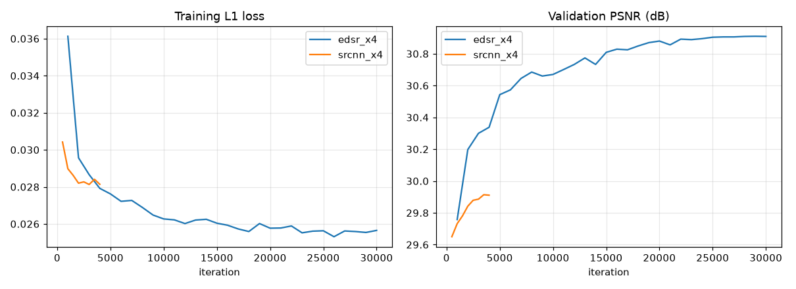
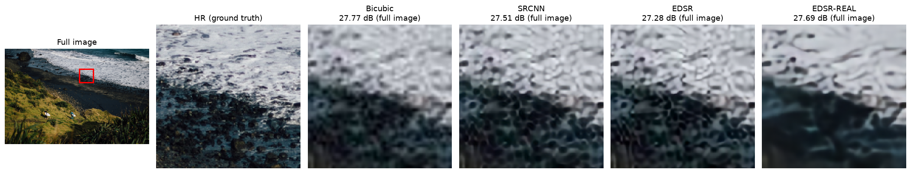

# Image Super-Resolution System

A deep-learning model that reconstructs high-resolution images from low-resolution inputs (×4 upscaling).

* **Models:** SRCNN (a small baseline CNN) and EDSR-baseline (a deep residual network with sub-pixel upsampling), compared against bicubic interpolation.
* **Data:** DIV2K. 400 2K-resolution training images (0001–0400, the part of the 800-image set hosted on the mirror we use) and 100 validation images. LR inputs are made by bicubic ×4 downscaling.
* **Metrics:** PSNR and SSIM on the Y channel, with a 4 px border shaved (the standard SR protocol).
* **Demo:** a Gradio web app to upload an image and compare bicubic with the super-resolved result.

## Project structure

```
sr/models.py       SRCNN, EDSR (+ EDSR-large config)
sr/data.py         DIV2K patch dataset (memory-mapped .npy, on-the-fly bicubic LR, flips/rotations)
sr/utils.py        degradation, PSNR/SSIM, tiled inference, checkpoint loading
download_data.sh   downloads DIV2K (Hugging Face mirrors)
prepare_data.py    unzips and converts training images to .npy
train.py           training loop (L1 loss, Adam, cosine LR, bf16 mixed precision, best-checkpoint saving)
evaluate.py        metrics table, visual comparisons, training curves -> results/
upscale.py         upscale a single image from the command line
app.py             Gradio web demo
```

## Setup (Windows, NVIDIA GPU)

```powershell
python -m venv .venv
.venv\Scripts\activate
pip install torch torchvision --index-url https://download.pytorch.org/whl/cu126
pip install -r requirements.txt
```

## Run

```powershell
bash download_data.sh          # ~2 GB (400 train + 100 validation images)
python prepare_data.py
python train.py --model srcnn --iters 5000
python train.py --model edsr  --iters 30000      # or add --minutes 60 to cap wall-clock time
python evaluate.py --checkpoints runs/srcnn_x4/best.pt runs/edsr_x4/best.pt
python upscale.py my_photo.jpg --checkpoint runs/edsr_x4/best.pt
python app.py                  # http://127.0.0.1:7860
```

## Method

**Problem.** Given LR image *y = (x ↓4)* produced by bicubic downscaling of HR image *x*, learn *f(y) ≈ x*.

**SRCNN** upsamples with bicubic, then refines with three conv layers (9×9 → 5×5 → 5×5) that predict a residual. It is small (about 69K parameters on RGB) and fast, but it works at HR resolution and has limited capacity.

**EDSR-baseline** works at LR resolution: conv head, then 16 residual blocks (64 channels, no batch-norm), then a global skip connection, then 2 PixelShuffle ×2 upsampling stages, then a conv. It has about 1.5M parameters. Removing batch-norm (as the EDSR paper proposes) keeps the range flexibility that SR needs.

**Training.** The model trains on random 48×48 LR / 192×192 HR patches with random flips and 90° rotations. It uses batch 16, L1 loss, Adam (lr 2e-4) with cosine decay, and bf16 autocast. The first 10 DIV2K validation images select the best checkpoint, and the remaining 90 are the held-out test set.

## Real-world degradation (EDSR-real)

Bicubic downscaling is clean, but real low-resolution photos are also blurry, noisy and JPEG-compressed. A model trained only on bicubic inputs sharpens those flaws instead of removing them. `sr/degrade.py` builds a simplified Real-ESRGAN-style degradation for each training patch:

1. **Blur:** with probability 0.8, an isotropic Gaussian (σ 0.2–2.5) or an anisotropic, rotated Gaussian (σx, σy 0.3–3).
2. **Downscale ×4:** with a random kernel (bicubic, bilinear, box or Lanczos).
3. **Noise:** with probability 0.7, Gaussian noise (σ 1–20), as colour or luminance noise.
4. **JPEG:** with probability 0.7, compression at quality 30–95.

EDSR-real is EDSR fine-tuned from the bicubic checkpoint on these inputs:

```powershell
python train.py --model edsr --degradation real --init runs/edsr_x4/best.pt --iters 12000 --lr 1e-4
python evaluate.py --degradation real --checkpoints runs/edsr_x4/best.pt runs/edsr_x4_real/best.pt --out results_real
```

Evaluation with `--degradation real` uses a fixed random seed per test image, so every method sees exactly the same degraded input.

## Results

All models were trained on an RTX 4050 Laptop GPU: SRCNN for 4k iterations (6.5 min), EDSR for 30k iterations (39 min) and EDSR-real for 12k fine-tuning iterations.

### Clean bicubic ×4 (90 held-out DIV2K validation images, Y channel)

| Method | PSNR (dB) | SSIM | Params |
|---|---|---|---|
| Bicubic | 28.01 | 0.7739 | – |
| SRCNN | 29.01 | 0.8046 | 0.07M |
| **EDSR** | **30.06** | **0.8313** | 1.52M |

EDSR improves on bicubic interpolation by **+2.05 dB PSNR** and on SRCNN by +1.05 dB, with 22× more parameters. Visual comparisons are in `results/comparisons/` and training curves in `results/curves.png`.




### Real-world degradation ×4 (blur + noise + JPEG)

Test set: 90 held-out DIV2K validation images, each degraded with random blur, noise and JPEG (fixed seed, so every method gets identical inputs).

| Method | PSNR (dB) | SSIM | Params |
|---|---|---|---|
| Bicubic | 25.94 | 0.6663 | – |
| SRCNN | 25.82 | 0.6447 | 0.07M |
| EDSR (bicubic-trained) | 25.49 | 0.6210 | 1.52M |
| **EDSR-real** | **27.17** | **0.7366** | 1.52M |

**Finding:** models trained only on clean bicubic data do *worse* than plain bicubic interpolation on realistic inputs (EDSR −0.45 dB), because they treat noise and JPEG blocks as detail and sharpen them. After fine-tuning on the degradation pipeline, EDSR-real gains **+1.23 dB over bicubic and +1.68 dB over EDSR**, and SSIM rises from 0.62 to 0.74. This shows that the training degradation must match the deployment conditions. One trade-off: EDSR-real outputs are cleaner but somewhat smoother. Adding a perceptual/GAN loss (as in ESRGAN) would restore sharper textures.



## Which model to use

| Input | Model |
|---|---|
| Clean small image (thumbnail, resized photo) | EDSR (best PSNR on clean inputs) |
| Real photo: phone, compressed, slightly blurry or noisy | EDSR-real |

## Limitations and future work

- Trained on 400 DIV2K natural images. Faces, text, cartoons and medical images need domain-specific data.
- L1 loss maximises PSNR but yields slightly smooth textures. A perceptual + adversarial loss (ESRGAN) would give sharper, more photo-realistic detail.
- Only ×4 was trained. The same code supports ×2, ×3 and ×8 via `--scale`.
- Larger models (`--model edsr-large`, 43M params) and longer training would add roughly 0.3–0.5 dB.
